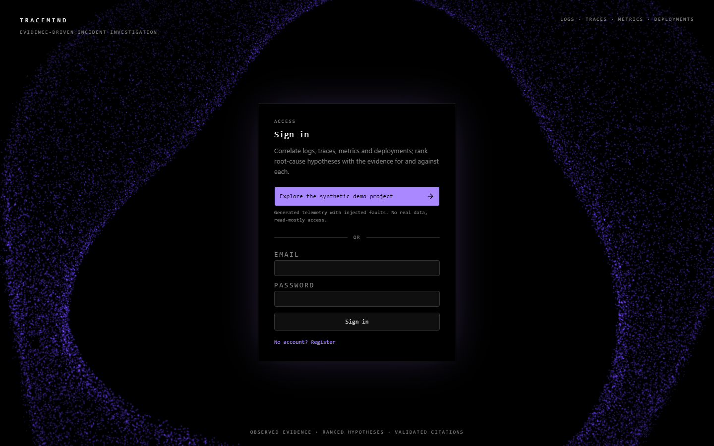
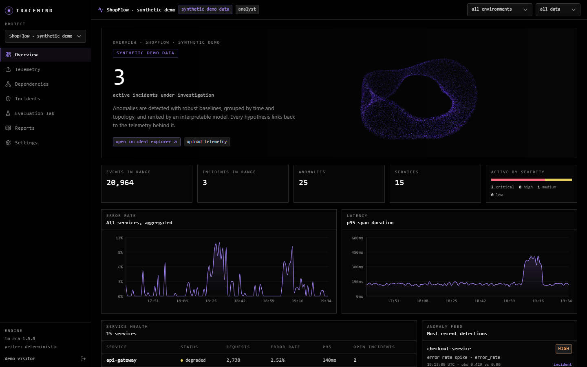
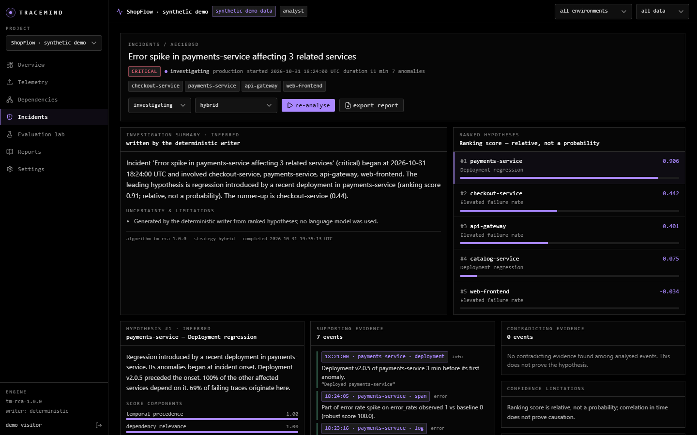
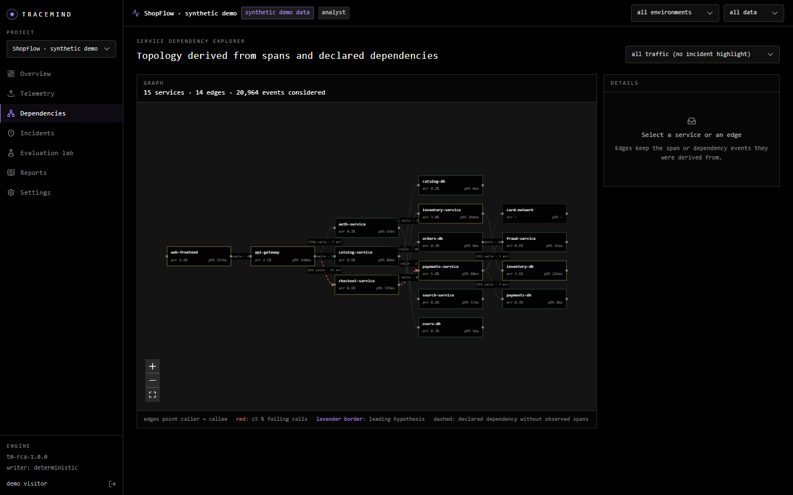

# TraceMind AI

**Evidence-driven incident investigation for distributed web applications.**

TraceMind ingests logs, distributed traces, metrics, deployment events and declared service dependencies. It then:

1. detects anomalies with robust statistics,
2. groups them into incidents by time and topology,
3. ranks plausible root causes with an interpretable model, and
4. writes investigation summaries in which every claim links back to a real telemetry event.

It keeps **observed evidence** separate from **inferred hypotheses**, labels ranking scores as *not probabilities*, and never treats correlation as proof of causation.

> Visual identity: a pure-black, lavender-accented research-lab aesthetic with an interactive WebGL particle ring driven by a GPU fluid simulation. It falls back to a CPU particle mode, then a static SVG, and respects `prefers-reduced-motion`.

| | |
|---|---|
|  |  |
|  |  |

*All screenshots show the clearly labelled synthetic demo project.*

---

## What works

| Area | Implemented |
|---|---|
| Ingestion | JSONL / CSV / TSV drag-and-drop upload; schema preview; timestamp normalisation (ISO, epoch s/ms/µs/ns, naive → UTC with warning); service-name mapping; in-file and cross-upload duplicate detection (content hash); per-row rejection reasons; secret/PII redaction; idempotency keys; progress tracking; raw file kept in object storage (local disk or S3) |
| Detection | Rolling median/MAD baselines with metric-specific scale floors, robust z-scores **plus** absolute thresholds, missing-data handling, baseline contamination guard, burst-based new-error-signature detection |
| Correlation | Union-find grouping by time window and dependency distance / shared traces; time-only fallback when no topology exists; deployment linking; chronological timeline |
| Dependency graph | Built from parent/child spans and explicit dependency events; every edge keeps the event IDs it was derived from; blast-radius traversal |
| Root-cause ranking | Weighted, inspectable components (temporal, dependency, anomaly strength, trace origin, error evidence, deployment proximity, contradiction penalty); supporting **and** contradicting evidence; per-hypothesis uncertainty text; read-only suggested checks |
| LLM writer | Anthropic Claude adapter (official SDK, JSON-schema structured output). The model sees a bounded, alias-referenced evidence bundle; prompt-injection text is flagged; schema and every citation are validated; fabricated references are removed or the whole output is rejected. Deterministic fallback when no provider is configured or it fails |
| Assistant | Incident Q&A with intent classification and lexical retrieval; cites events; says explicitly when evidence is insufficient |
| Evaluation lab | Seeded synthetic fault generator (4 fault types, noise blips, decoy deployments, missing trace IDs, multi-fault scenarios). Rules-only baseline + 6 configurations / ablations. Top-1/top-3 accuracy, anomaly precision/recall, invalid-citation rate, latency. JSON/CSV export |
| Reports | Server-side Markdown postmortems with overview, services, timeline, ranked hypotheses, evidence, read-only checks, limitations and provenance |
| Platform | Cookie/JWT auth, project-scoped RBAC (owner/editor/analyst/viewer, non-members get 404), public read-mostly demo, rate limits, request-size limits, timeouts, structured JSON logs, consistent error envelope, Alembic migrations, Docker Compose, GitHub Actions |

## Recorded results (held-out seed 42, 40 scenarios, 46 injected faults)

| Configuration | Top-1 | Top-3 | Single-fault top-1 |
|---|---|---|---|
| Rules-only baseline | 54.3% | 87.0% | 61.8% |
| Temporal only | 30.4% | 89.1% | 41.2% |
| Dependency-aware | 80.4% | 97.8% | 91.2% |
| **Hybrid (default)** | **87.0%** | **100%** | **100%** |

Anomaly precision 75.7%, recall 99.0%. Invalid-citation rate 0.0% (2,890 citations checked, deterministic writer). Mean analysis latency about 0.6 s per scenario (Windows laptop, Python 3.11). On scenarios with **two concurrent faults**, top-1 accuracy is 50%, because both faults are usually grouped into one incident. These are synthetic scenarios, so treat the numbers as an upper bound, not a production promise. Full details: [docs/evaluation.md](docs/evaluation.md). Raw results: [benchmarks/results](benchmarks/results).

---

## Quick start (Docker)

```bash
cp .env.example .env
```

```bash
docker compose up --build
```

Open http://localhost:3000 and choose **Explore the synthetic demo project**. On first start the API runs migrations, generates the synthetic ShopFlow dataset (≈21k events, two injected faults, a decoy deployment and a noise blip) and analyses its incidents.

> **Troubleshooting:** if the backend exits with `password authentication failed`, the database volume was created with a different `POSTGRES_PASSWORD` than your current `.env`. Either restore the old password in `.env`, or reset local data with `docker compose down -v`.

## Deploying (Render, free plan)

`render.yaml` defines a one-click Render Blueprint: a free PostgreSQL database plus one free web service built from `deploy/render.Dockerfile`, which runs the Next.js UI and the FastAPI backend in a single container. In Render choose **New → Blueprint**, select this repository and click **Apply**. A secret key is generated automatically. See [docs/deployment.md](docs/deployment.md) for details and free-plan limits.

To try uploads, register an account, create a project in **Settings**, and upload `samples/shopflow-sample.jsonl` (or the deliberately broken `samples/malformed-sample.jsonl`).

## Local development (without Docker)

Backend (Python 3.11+). It uses SQLite by default; set `TRACEMIND_DATABASE_URL` for PostgreSQL:

```bash
cd backend
python -m venv .venv
source .venv/bin/activate        # Windows PowerShell: .venv\Scripts\Activate.ps1
pip install -r requirements-dev.txt
alembic upgrade head
uvicorn app.main:app --reload --port 8000
```

Frontend (Node 24+), in a second terminal:

```bash
cd frontend
npm install
npm run dev
```

The dev server expects the API at `http://127.0.0.1:8000`; set `BACKEND_URL` if yours is elsewhere. Open http://localhost:3000.

## Tests and checks

```bash
cd backend && ruff check app tests && pytest -q
```

```bash
cd frontend && npm run lint && npm run typecheck && npm run build
```

```bash
cd frontend && E2E_BASE_URL=http://localhost:3000 npx playwright test
```

```bash
cd backend && python -m app.bench.runner --seed 42 --scenarios 40 --out ../benchmarks/results
```

Last verified run: 62 backend tests passed; frontend lint, typecheck and production build clean; 5/5 Playwright tests passed against the Docker Compose stack (PostgreSQL 17), including every page with no browser console errors and no sideways scrolling at phone width.

## Enabling the LLM writer

The app is fully usable without a model. To use Claude for summaries and assistant answers:

```env
TRACEMIND_LLM_PROVIDER=anthropic
TRACEMIND_LLM_MODEL=claude-opus-5-5
TRACEMIND_LLM_API_KEY=...     # or ANTHROPIC_API_KEY
```

Any provider error, refusal, truncation, schema violation or majority-fabricated citation falls back to the deterministic writer. The UI shows which writer produced each text and why a fallback happened.

## Repository layout

```
backend/            FastAPI app, analysis engine, LLM layer, benchmark, Alembic, tests
  app/analysis/     anomaly.py · correlation.py · graph.py · ranking.py · pipeline.py
  app/ingestion/    normalize.py (parsing, validation, redaction, hashing)
  app/llm/          providers.py · evidence.py · validation.py · writer.py
  app/bench/        generator.py (fault injection) · runner.py · samples.py
  app/services/     ingestion, detection, analysis, evaluation, overview, jobs
frontend/           Next.js 16 App Router, Tailwind 4, shadcn/ui, React Flow, Recharts, Three.js
  src/components/particles/ParticleField.tsx   GPU fluid particle ring
  e2e/              Playwright workflows
samples/            reproducible sample datasets (+ ground truth)
benchmarks/results  recorded benchmark output (held-out seed 42; development seed 7)
docs/               architecture, database, API, algorithms, evaluation, security, deployment, demo, report outline, resume
```

## Documentation

- [Architecture](docs/architecture.md) · [Database](docs/database.md) · [API](docs/api.md)
- [Algorithms](docs/algorithms.md) · [Evaluation](docs/evaluation.md) · [Security](docs/security.md)
- [Deployment](docs/deployment.md) · [Demo workflow](docs/demo-workflow.md)
- [Technical report outline](docs/technical-report-outline.md) · [Resume description](docs/resume.md)

## Known limitations

- Background jobs run on an in-process thread pool. That's fine for one API instance; multiple replicas need a durable queue (RQ/Celery) and a shared rate-limit store (Redis).
- Concurrent faults in different branches are often merged into one incident, so only one of them can rank first.
- The benchmark is synthetic. Real telemetry is noisier, sparser and less consistently traced.
- Deployment to a public host has **not** been performed from this repository. The deployment guide describes the steps, but none have been executed.
