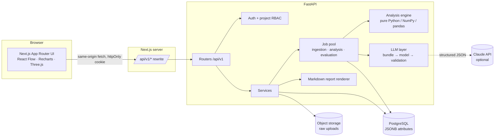
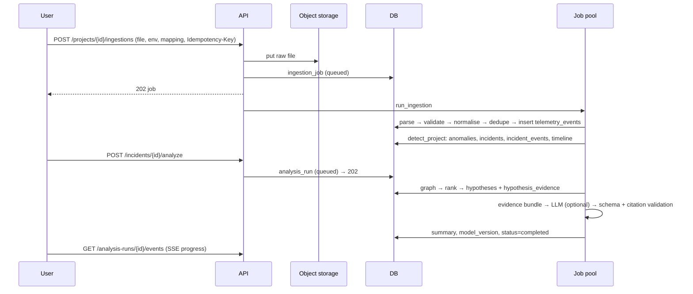
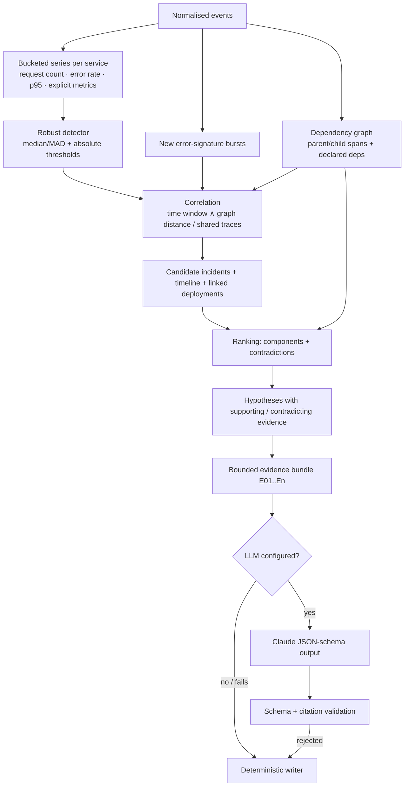

# Architecture

## System overview

* The browser only talks to its own origin. Next.js rewrites `/api/v1/*` to FastAPI, so the session cookie stays first-party (`HttpOnly`, `SameSite=Lax`). Bearer tokens are also accepted for scripts.
* The analysis engine (`backend/app/analysis`) has **no database dependency**: it consumes `Event` dataclasses. The API, the seed and the benchmark therefore all run the exact same code.
* Expensive work (ingestion, analysis, benchmarks) runs asynchronously. Endpoints return a job/run ID; progress is persisted and exposed by polling and by server-sent events (`/analysis-runs/{id}/events`).

## Data flow

## Analysis pipeline

See [algorithms.md](algorithms.md) for the maths and thresholds.

## Frontend

| Route | Purpose |
|---|---|
| `/login` | Demo entry, sign in / register, particle ring centrepiece |
| `/` | Overview: particle hero, stats, severity distribution, error-rate & latency charts, service health, anomaly feed, deployments, recent investigations |
| `/ingest` | Drag-and-drop upload, preview, mapping, progress, history, normalised event browser |
| `/services` | React Flow dependency explorer, incident highlighting, node detail, edge evidence |
| `/incidents` | Searchable, filterable, sortable, paginated incident table |
| `/incidents/[id]` | Investigation workspace: summary, ranked hypotheses, score components, supporting/contradicting evidence, limitations, checks, charts with deployment markers, timeline, scoped graph, assistant, anomalies |
| `/evaluation` | Benchmark runner and results across configurations |
| `/reports` | Generated Markdown reports, preview and download |
| `/settings` | Project creation, environments, analysis thresholds, members and roles |

Every evidence reference opens a drawer that loads `/events/{id}` and shows timestamp, service, type, severity, IDs, the verbatim (untrusted) message, attributes and ingestion provenance.

Authenticated routes render their chrome immediately. Pages suspend on the client-side session (`useSession` uses React `use()` on a session promise) behind per-segment `loading.tsx` boundaries. This keeps Next 16 Cache Components / instant-navigation validation satisfied.

### Particle system

`ParticleField.tsx` builds about 26k points on a hollow, flattened, 1.5-turn twisted torus with varying thickness. Rendering uses one of three tiers:

1. **Fluid** (WebGL2 with `EXT_color_buffer_float` and vertex texture fetch): a 128² half-float stable-fluids solver (advect → divergence → 12 Jacobi pressure iterations → gradient subtract, with dissipation). The pointer splats velocity into the field. The vertex shader samples the field at each particle's screen position and offsets it, so particles flow and then settle back as the field decays.
2. **CPU**: per-particle spring and repulsion.
3. **Static**: an SVG ring.

The camera eases toward the pointer. Rendering pauses off-screen and in hidden tabs, renders one still frame under reduced motion, and drops to a lower tier on context loss.
