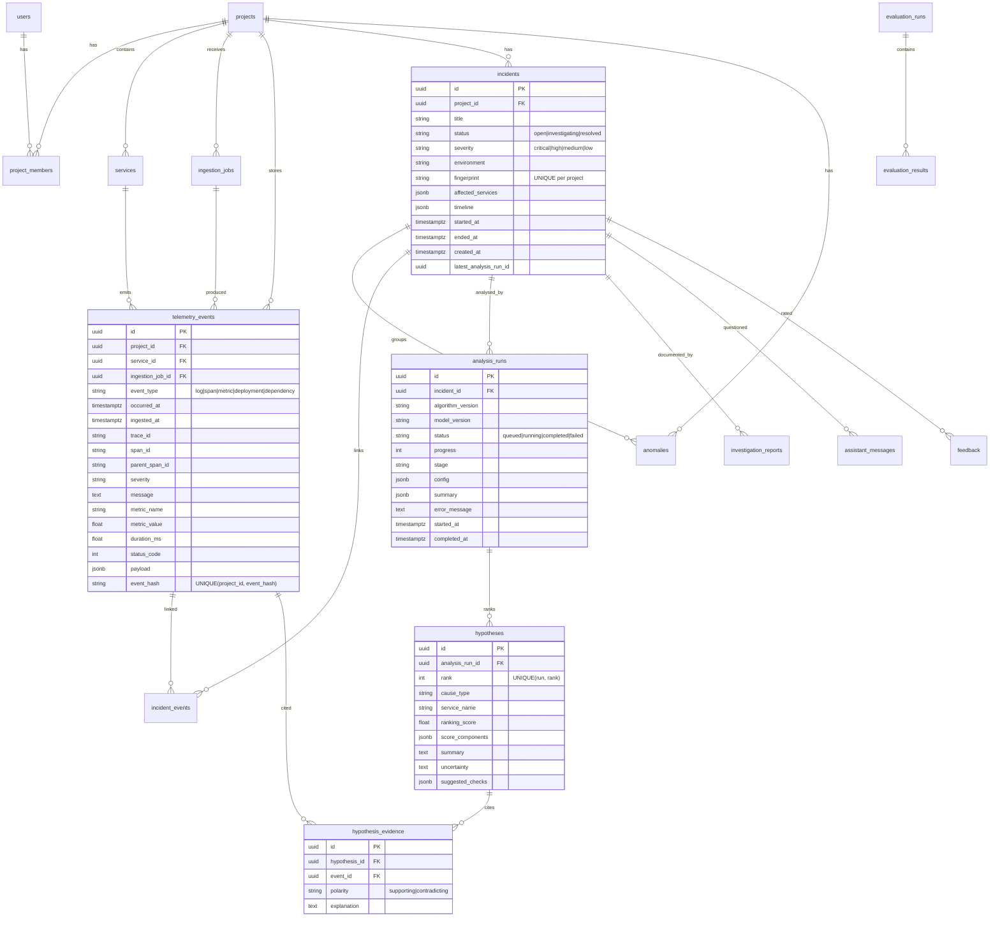

# Database

PostgreSQL 17 (tested), managed by Alembic (`backend/alembic/versions/0001_initial_schema.py`). Conventions:

- UUID primary keys
- timezone-aware UTC timestamps (`TIMESTAMP WITH TIME ZONE`)
- `JSONB` for flexible attributes
- foreign keys with explicit `ON DELETE`
- check constraints on enums
- unique constraints for idempotency

SQLite is supported for tests through type variants.



## Tables

| Table | Notes |
|---|---|
| `users` | email (unique), PBKDF2-SHA256 hash, `is_demo` flag |
| `projects` | name, unique slug, `environments` (JSONB), `analysis_settings` (JSONB, validated ranges), `is_demo` |
| `project_members` | role ∈ owner/editor/analyst/viewer, unique (project, user). Basis of every authorization check |
| `services` | unique (project, name, environment), kind, first/last seen |
| `ingestion_jobs` | file metadata, sha256, `storage_key` (raw file lives in object storage, not in a row), status, row counters, first 500 row errors, detection summary, unique (project, idempotency_key) |
| `telemetry_events` | normalised events; unique (project, event_hash) makes re-ingestion idempotent. Indexes: (project, occurred_at), (project, trace_id), (service, occurred_at), (project, event_type, occurred_at) |
| `anomalies` | type, metric, baseline, observed, robust score, severity, window, supporting event IDs; unique fingerprint per project |
| `incidents` | grouped anomalies, persisted timeline, fingerprint; index (project, started_at) |
| `incident_events` | event links with role anomaly/deployment/timeline; unique (incident, event) |
| `analysis_runs` | algorithm and model versions, progress/stage, config snapshot, summary + writer metadata |
| `hypotheses` / `hypothesis_evidence` | ranked causes, component scores, polarity-tagged evidence |
| `investigation_reports` | Markdown snapshot with algorithm/model versions |
| `assistant_messages` | question, validated answer, writer metadata |
| `feedback` | verdict on a hypothesis/run (correct, partially_correct, incorrect) |
| `evaluation_runs` / `evaluation_results` | benchmark configuration, aggregate metrics, per-scenario per-strategy rows |

## Idempotency

- **Uploads**: an `Idempotency-Key` header returns the existing job. Identical events are skipped via `event_hash`.
- **Detection**: anomalies are fingerprinted by (service, type, metric, window start). Incidents are matched by time overlap and shared services, then updated in place. Superseded incidents that were never analysed are removed.
- **Analysis**: one in-flight run per incident. A repeated `POST /analyze` returns the active run.

## Commands

```bash
alembic upgrade head      # apply
alembic check             # verify models match migrations
alembic downgrade base    # roll back
```
